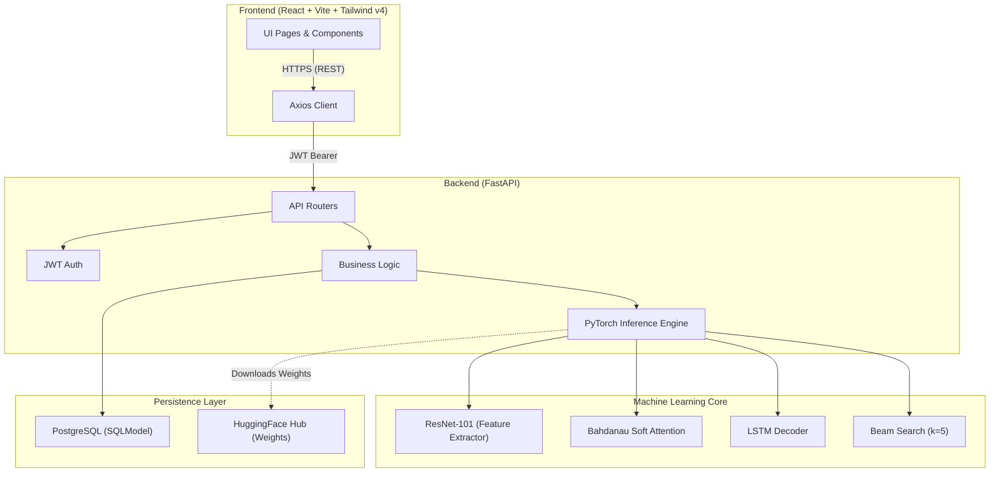
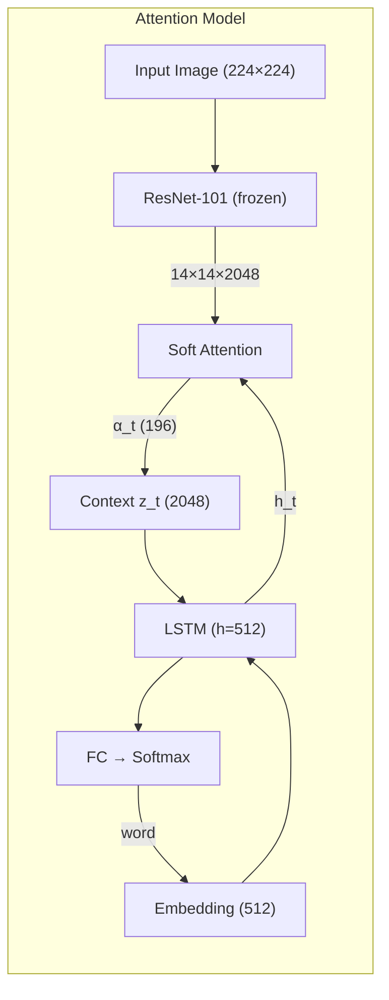

# System Architecture

The NeuralCaption application is designed as a modern, decoupled, three-tier architecture utilizing best practices in Machine Learning integration, microservices, and reactive frontend design.

## 1. High-Level Architecture

## 2. Machine Learning Flow (Show, Attend and Tell)

The core ML pipeline is heavily inspired by the paper *Show, Attend and Tell*. 

## 3. Data Flow: Generating a Caption

1. **User Upload**: The user uploads an image via the React Frontend (`CaptionPage.tsx`).
2. **API Request**: The image is sent to the FastAPI Backend via a `multipart/form-data` POST request to `/api/v1/caption/`.
3. **Inference Trigger**: The FastAPI router validates the image and calls `caption_image_beam_search()` in the PyTorch Inference Engine.
4. **ResNet Extraction**: The image is transformed and passed through the frozen ResNet-101 to extract `(14, 14, 2048)` spatial features.
5. **Beam Search Decoding**: The LSTM decoder, guided by the Attention mechanism, generates the caption sequentially, tracking the `alpha` weights (attention) at each step.
6. **API Response**: The generated caption text and the array of attention weights are returned to the client as JSON.
7. **Frontend Rendering**: The React app renders the caption. When a word is hovered, the corresponding `alpha` weights are dynamically transformed into a CSS glassmorphism overlay on the image preview.
